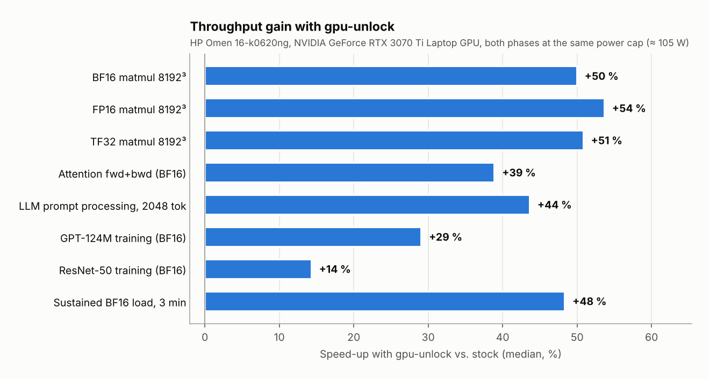
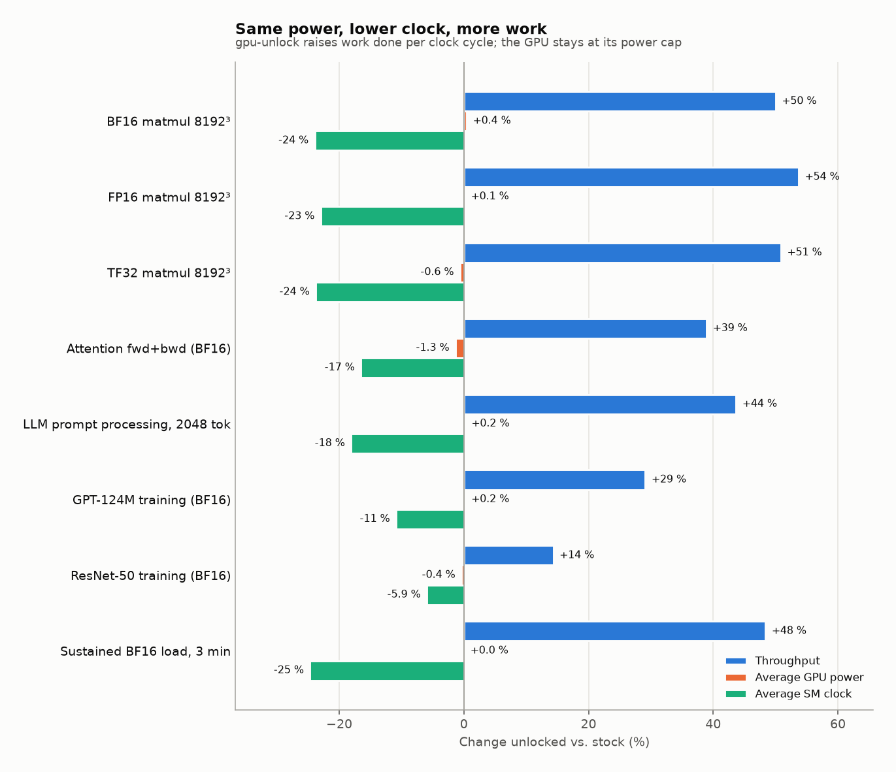

# RTX 3070 Ti Laptop GPU – gpu-unlock benchmark

A reproducible before/after benchmark of [Zagitta/gpu-unlock](https://github.com/Zagitta/gpu-unlock) on an
NVIDIA GeForce RTX 3070 Ti **Laptop** GPU (GA104, `10de:24e0`) in an HP Omen 16-k0620ng. gpu-unlock is a Linux kernel module that removes the
half-rate limit on FP16/BF16/TF32 tensor-core math with FP32 accumulation on GeForce Ampere cards. At the time of
writing, no laptop GPU had been reported in its compatibility list.

The suite runs an identical test list twice, once on the stock card (**baseline**) and once with gpu_unlock active
(**unlocked**). It then produces a report with validity checks, all raw logs and SHA-256 checksums.

## Results at a glance

<picture>
  <source media="(prefers-color-scheme: dark)" srcset="reports/series1-pytorch/charts/headline_dark.png">
  
</picture>

| Workload | Stock | Unlocked | Change |
|---|---:|---:|---:|
| BF16 matrix multiply 8192³ (FP32 acc.) | 33.5 TFLOPS | 50.2 TFLOPS | **+50 %** |
| FP16 matrix multiply 8192³ (FP32 acc.) | 34.0 TFLOPS | 52.3 TFLOPS | **+54 %** |
| TF32 matrix multiply 8192³ | 16.9 TFLOPS | 25.5 TFLOPS | **+51 %** |
| LLM prompt processing, 2048 tokens (BF16) | 15,452 tok/s | 22,200 tok/s | **+44 %** |
| GPT-124M training (BF16) | 20,318 tok/s | 26,232 tok/s | **+29 %** |
| LLM token generation, batch 1 | 148 tok/s | 150 tok/s | +1 % |

### Same power, more work: efficiency

The laptop GPU sits at its power cap (≈ 105 W enforced) under tensor load in both phases. gpu-unlock does not
raise that cap. The card draws the same ~103 W and runs at a **lower** SM clock (1,459 → 1,099 MHz in the sustained
test), yet finishes **48 % more work**, because each tensor-core instruction now completes at the full rate.

- **+48 % work per watt** in the 3-minute sustained BF16 load, **−33 % energy** per unit of work
- **−30 % energy per token** for LLM prompt processing: 1.85 Wh → 1.29 Wh per million prompt tokens
- Less heat for the same job, and more work per battery charge

<picture>
  <source media="(prefers-color-scheme: dark)" srcset="reports/series1-pytorch/charts/efficiency_dark.png">
  
</picture>

**Trustworthy comparison.** Every validity check passed: same driver, kernel, software and power cap. Control
tests (FP32, INT8, memory bandwidth) stayed unchanged within ±2 %. GEMM outputs are bit-identical in both phases,
and a repeat run of the unlocked phase reproduced the results within 0.6 %.

**Full report** with every test, power/thermal data and raw logs: [series 1 – PyTorch](reports/series1-pytorch/report.md)  
### Series 2: llama.cpp with real GGUF models

One model (Qwen2.5-3B-Instruct) in four weight formats, all created from the same BF16 file, measured with
`llama-bench` (7 repetitions, all layers on the GPU, flash attention off and on).

<picture>
  <source media="(prefers-color-scheme: dark)" srcset="reports/llamacpp/series2-llamacpp/charts/llamacpp_change_dark.png">
  
</picture>

| Prompt processing, 2048 tokens, flash attention on | Stock | Unlocked | Change |
|---|---:|---:|---:|
| BF16 | 3,902 tok/s | 4,983 tok/s | **+28 %** |
| F16 | 5,049 tok/s | 5,056 tok/s | +0.1 % |
| Q8_0 | 5,449 tok/s | 5,515 tok/s | +1.2 % |
| Q4_K_M | 5,119 tok/s | 5,235 tok/s | +2.3 % |
| Token generation, all formats | | | within ±1.1 % |

**Only BF16 models benefit.** llama.cpp computes BF16 weights with FP32 accumulation, which is exactly the path
gpu-unlock opens. Stock BF16 is 23 % slower than F16 at prompt processing; unlocked, it is on par. F16 weights use FP16
accumulation, which was never rate-limited on GeForce. Q8_0 and Q4_K_M run on INT8 kernels. Both stay within
run-to-run noise. **For everyday quantized GGUF use (Ollama, LM Studio) the unlock brings no measurable gain**; the
benefit is in BF16 and PyTorch workloads (series 1). All 16 validity checks passed (same llama.cpp build,
SHA-256-identical model files).

**Full report:** [series 2 – llama.cpp](reports/llamacpp/series2-llamacpp/report.md)

## What is measured

| Category | Tests | Expected effect |
|---|---|---|
| Correctness | FP16/BF16/TF32/FP32 2048³ GEMM output hash + error vs FP64 (also verifies the TF32 switch) | identical |
| GEMM | FP16, BF16, TF32 at 2048/4096/8192 | **gain** |
| GEMM controls | FP32 (CUDA cores, TF32 off), INT8 (`torch._int_mm`) | none |
| Memory | 1 GiB device copy | none (control) |
| Kernels | SDPA attention fwd / fwd+bwd, 3×3 convolution (cuDNN) | gain / partial |
| LLM | prompt processing 512/2048 tokens, token generation batch 1 and 16 (synthetic ~0.95 B Llama-style model) | gain / info / partial |
| Training | GPT-style 124 M (BF16 and FP16), ResNet-50 (BF16) | gain / partial |
| Inference | ResNet-50 FP16; optional Stable Diffusion via diffusers | partial / gain |
| Sustained | BF16 8192³ GEMM for 180 s in 5 s windows | gain; shows power/thermal limits |

Every throughput test is warmed up, then measured as 5 samples of about 2 s each with CUDA events. Before each test
the GPU idles until it is at or below 55 °C. Power, clocks, temperature and NVML throttle reasons are logged at 10 Hz.
Control tests, which must not change, confirm that the two boots differ only in the unlock.

## Requirements

- Ubuntu 24.04 (or similar), NVIDIA driver ≥ 580, Python 3.10+
- Power adapter connected, platform profile `performance`
- NVIDIA Runtime D3 disabled (`./run.sh prepare`). Otherwise the GPU powers off when idle and loses the unlock.

## Usage

```bash
./setup_env.sh            # venv + PyTorch (CUDA) + nvidia-ml-py + matplotlib; WITH_SD=1 adds diffusers
./run.sh prepare          # one-time: disable Runtime D3, performance profile -> reboot
./run.sh status           # shows unlock state, profile, AC, Runtime D3
./run.sh smoke            # 2-3 min functional check of every test
./run.sh baseline         # stock card, ~30-40 min
./run.sh install-unlock   # installs gpu-unlock + kernel parameter -> reboot
./run.sh unlocked         # unlocked card, ~30-40 min
./run.sh compare --system "HP Omen 16-k0620ng"   # report from the newest baseline + unlocked run
./run.sh remove-unlock    # back to stock -> reboot
```

Useful options for `baseline`/`unlocked`: `--samples 7`, `--sustained-sec 300`, `--only 'gemm_.*_8192'`,
`--skip resnet`, `--sd-model stabilityai/sd-turbo`, `--label <note>`. See `python bench/suite.py --help`.

## Output

```
results/<timestamp>_<phase>/
  run.log          human-readable log
  env.json, env/   environment summary and verbatim command outputs (nvidia-smi -q, lspci, kernel log …)
  results.jsonl    one JSON record per test: all samples, statistics, telemetry, parameters
  results.csv      one row per test
  telemetry.csv    10 Hz GPU telemetry tagged with the running test
  sustained_*.csv  per-window timeline of the sustained test
  summary.md       per-run table
  manifest.json    SHA-256 of every file
reports/<timestamp>_<baseline>_vs_<unlocked>/
  report.md        the publishable report (validity checks, results, charts)
  compat_report.md pre-filled gpu-unlock compatibility report
  comparison.csv / comparison.json / compare.log / charts/*.png
logs/              setup and admin actions (prepare, install-unlock, remove-unlock)
```

## Test series 2: llama.cpp with GGUF models

Most people run quantized GGUF models with llama.cpp, Ollama or LM Studio, not BF16 PyTorch. This series measures
that case with `llama-bench`. It uses one source model (default `Qwen/Qwen2.5-3B-Instruct`), converted once to BF16
GGUF and quantised from that file into F16, Q8_0 and Q4_K_M, so every variant is the same network and fits into 8 GB.

In the current llama.cpp CUDA backend each weight format takes a different path, which predicts the result:

| Weights | Prompt processing path | Expected effect of the unlock |
|---|---|---|
| BF16 | cuBLAS, BF16 inputs, **FP32 accumulation** | large (the unlocked path) |
| F16 | cuBLAS, FP16 inputs, FP16 accumulation | small (not rate-limited on GeForce) |
| Q8_0, Q4_K_M | MMQ kernels, INT8 tensor cores | small |
| any (token generation) | memory-bandwidth bound | none (control) |

Each weight format is tested for prompt processing (512 and 2048 tokens) and token generation (128 tokens), with
flash attention off and on. Each test has 7 repetitions, preceded by the same thermal cool-down and telemetry as series 1.

```bash
./llama.sh setup      # CUDA toolkit if missing, llama.cpp build (sm_86), model download/convert/quantize (~30-60 min, ~35 GB disk)
./llama.sh smoke      # ~3 min functional check
./llama.sh baseline   # stock card, ~25-35 min
./llama.sh unlocked   # gpu_unlock active, ~25-35 min
./llama.sh compare    # report in reports/llamacpp/
```

Use a different model with `HF_MODEL=org/name ./llama.sh setup`. Choose variants with `QUANTS="BF16 Q4_K_M"`. Pin
llama.cpp with `LLAMA_CPP_REF=<tag>`. Results go to `results/llamacpp/<timestamp>_<phase>/`. The raw `llama-bench` JSON
of every test is kept in `raw/`.

## Disclaimer

gpu-unlock is experimental third-party software that writes undocumented GPU registers. This repository only
measures its effect. Use at your own risk.

## License

The benchmark scripts, reports and measurement data in this repository are released under the [MIT License](LICENSE).
gpu-unlock itself is not part of this repository and is licensed separately by its authors (GPL-2.0).
