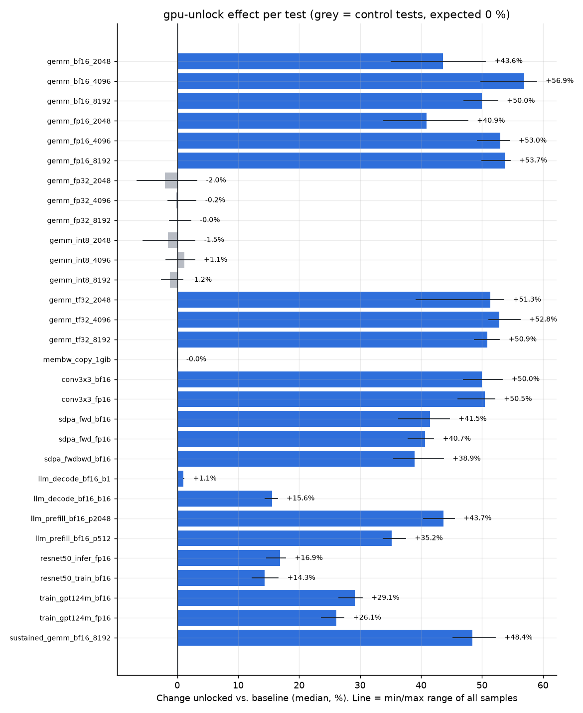
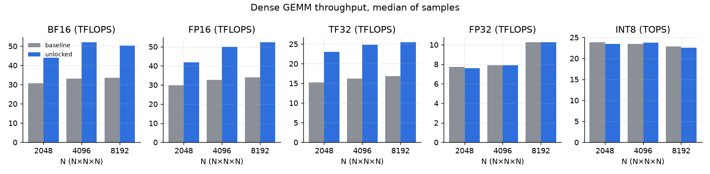
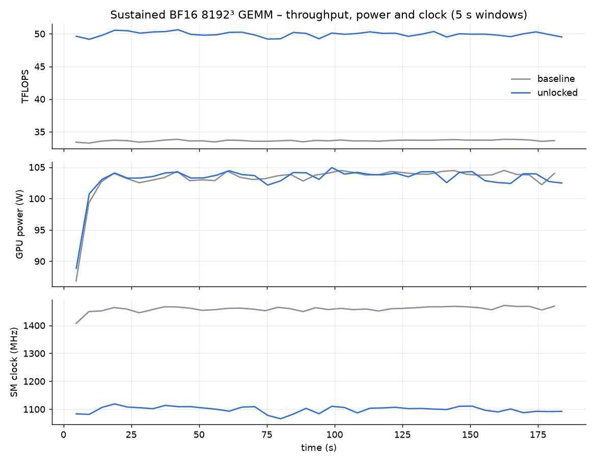

# NVIDIA GeForce RTX 3070 Ti Laptop GPU – gpu-unlock benchmark: baseline vs. unlocked

*Generated 2026-10-26T11:08:07.370+01:00 by the benchmark suite v1.0.0. Baseline run `20261026-100526_baseline`, unlocked run `20261026-104640_unlocked`.*

## Summary

| Workload | Baseline | Unlocked | Change |
|---|---:|---:|---:|
| BF16 GEMM 8192³ (FP32 acc.) | 33.48 TFLOPS | 50.23 TFLOPS | **+50.0 %** |
| FP16 GEMM 8192³ (FP32 acc.) | 34.03 TFLOPS | 52.31 TFLOPS | **+53.7 %** |
| TF32 GEMM 8192³ | 16.87 TFLOPS | 25.46 TFLOPS | **+50.9 %** |
| Attention fwd+bwd, BF16 | 30.00 TFLOPS | 41.68 TFLOPS | **+38.9 %** |
| LLM prompt processing (2048 tok) | 15,451.60 tokens/s | 22,199.93 tokens/s | **+43.7 %** |
| LLM token generation (batch 1) | 148.16 tokens/s | 149.72 tokens/s | **+1.1 %** |
| GPT-124M training, BF16 | 20,318.14 tokens/s | 26,231.97 tokens/s | **+29.1 %** |
| ResNet-50 training, BF16 | 476.49 images/s | 544.83 images/s | **+14.3 %** |
| Sustained BF16 GEMM (median of all windows) | 33.66 TFLOPS | 49.95 TFLOPS | **+48.4 %** |

The largest GEMM gain is **+56.9 %** (`gemm_bf16_4096`). Control tests moved by at most 2.0 % (`gemm_fp32_2048`), so the two boots are otherwise comparable. End-to-end workloads: `llm_prefill_bf16_p2048` +43.7 %, `llm_prefill_bf16_p512` +35.2 %, `train_gpt124m_bf16` +29.1 %, `train_gpt124m_fp16` +26.1 %, `resnet50_infer_fp16` +16.9 %, `llm_decode_bf16_b16` +15.6 %, `resnet50_train_bf16` +14.3 %, `llm_decode_bf16_b1` +1.1 %.

## Test system

| | |
|---|---|
| GPU | NVIDIA GeForce RTX 3070 Ti Laptop GPU (0x24E010DE, subsystem 0x8A4C103C) |
| SMs / VRAM | 46 SMs, 7842 MiB |
| VBIOS | 94.04.7C.00.10 |
| Power limit | [N/A] (default 80.00 W, max 150.00 W), Dynamic Boost Supported, nvidia-powerd active |
| Host | 12th Gen Intel(R) Core(TM) i9-12900H, 15 GiB RAM |
| OS / kernel | Ubuntu 24.04.5 LTS, 7.0.0-38-generic |
| NVIDIA driver | 595.99.02 (open kernel modules) |
| Software | PyTorch 2.14.1+cu130, CUDA 13.0, cuDNN 92400, Python 3.12.3, torchvision 0.29.1+cu130 |
| gpu-unlock | af28cbb 2026-10-24 Merge pull request #37 from tsondo/claude/wizardly-turing-ecpa8w (version 1.0.0) |
| Conditions | platform profile `performance`, AC power True, NVIDIA Runtime D3 `Disabled` |
| Idle reference | baseline 17.7 W / 37 °C, unlocked 18.1 W / 40 °C |

## Validity checks

| Check | Result | Detail |
|---|---|---|
| Baseline boot is stock | pass | state=stock, cmdline targets=None |
| Unlocked boot reports 'gpu_unlock: unlocked' | pass | state=unlocked, log lines=17 |
| Same NVIDIA driver | pass | 595.99.02 / 595.99.02 |
| Same VBIOS | pass | 94.04.7C.00.10 / 94.04.7C.00.10 |
| Same Max power limit | pass | 150.00 W / 150.00 W |
| Same PCI device | pass | 0x24E010DE / 0x24E010DE |
| Same kernel | pass | 7.0.0-38-generic / 7.0.0-38-generic |
| Same platform profile | pass | performance / performance |
| Same AC power | pass | True / True |
| Same Runtime D3 setting | pass | Disabled / Disabled |
| Same PyTorch / CUDA / cuDNN | pass | 2.14.1+cu130/13.0/92400 vs 2.14.1+cu130/13.0/92400 |
| Same suite version | pass | 1.0.0 / 1.0.0 |
| No run was forced past preflight | pass | - / - |
| Control tests unchanged (±5 %) | pass | gemm_fp32_2048 -2.0%, gemm_int8_2048 -1.5%, gemm_fp32_4096 -0.2%, gemm_int8_4096 +1.1%, gemm_fp32_8192 -0.0%, gemm_int8_8192 -1.2%, membw_copy_1gib -0.0% |
| Measurement noise acceptable (max CV < 5 %) | pass | median CV 0.97 %, worst 2.89 % |

### Numerical correctness

A fixed-seed 2048³ GEMM is run twice in each phase. Its output is hashed (SHA-256) and compared with an FP64 reference computed on the GPU.

| Test | Bit-identical across phases | Deterministic within run (B / U) | Max rel. error vs FP64 (B / U) |
|---|---|---|---|
| correct_gemm_bf16 | yes (`c52bec3916e9d732` / `c52bec3916e9d732`) | True / True | 2.107e-03 / 2.107e-03 |
| correct_gemm_fp16 | yes (`0b110e7143b303ca` / `0b110e7143b303ca`) | True / True | 2.663e-04 / 2.663e-04 |
| correct_gemm_fp32 | yes (`1f14b56c462a138c` / `1f14b56c462a138c`) | True / True | 2.282e-06 / 2.282e-06 |
| correct_gemm_tf32 | yes (`f7b3e0f53b4f12b5` / `f7b3e0f53b4f12b5`) | True / True | 3.199e-04 / 3.199e-04 |

## Method

- Both phases run the identical test list on the same machine and software stack. The only difference is `gpu_unlock.targets=` on the kernel command line (the module then unlocks the card before the unmodified NVIDIA driver binds it).
- Every throughput test: 3 s warm-up, then 5 samples of ~2 s each, timed with CUDA events. Reported value = median of the samples; the min/max range of all samples is given as well.
- Before each test the GPU idles until it is at or below 55 °C (at least 10 s, at most 120 s), so both phases start each test from a comparable thermal state.
- GPU power, clocks, temperature and NVML throttle reasons are sampled at 10 Hz during every measurement window (`telemetry.csv`). Implausible power readings (above 1.5× the maximum power limit) are discarded and counted.
- *Sep.* (separated) means the sample sets of both phases do not overlap at all (for 5 vs 5 samples an exact two-sided Mann–Whitney p of 0.008). The samples of one phase come from a single boot and are not fully independent, so this captures run-to-run noise, not boot-to-boot variation; repeating each phase on a second boot is the stronger test.
- FP16/BF16 GEMMs run with reduced-precision split-K reductions disabled, so accumulation is FP32 throughout. cuDNN autotuning (`cudnn.benchmark`) is on in both phases.
- Expectation labels: **gain** = path the unlock targets (FP16/BF16/TF32 tensor math with FP32 accumulation); **partial** = workloads that only partly use that path; **control** = must not change (FP32 on CUDA cores, INT8 tensor math, memory bandwidth); **info** = expected roughly unchanged but sensitive to CPU/launch overhead (batch-1 token generation). Control tests check that nothing else changed between the two boots.
- LLM tests use a synthetic Llama-style ~0.95 B parameter model with random weights, so no model download is needed; throughput does not depend on weight values.

## Results

### GEMM micro-benchmarks

| Test | Expect | Baseline | Unlocked | Change | Range | Sep. | Power B→U (W) | Perf/W | SM clock B→U (MHz) | Max °C B→U |
|---|---|---:|---:|---:|---|:-:|---|---:|---|---|
| gemm_fp16_2048 | gain | 29.68 | 41.82 TFLOPS | **+40.9 %** | +33.9 % … +47.7 % | yes | 100 → 100 | +40.7 % | 1,385 → 1,046 | 50 → 52 |
| gemm_bf16_2048 | gain | 30.69 | 44.06 TFLOPS | **+43.6 %** | +35.1 % … +50.6 % | yes | 101 → 101 | +43.3 % | 1,429 → 1,098 | 54 → 56 |
| gemm_tf32_2048 | gain | 15.24 | 23.06 TFLOPS | **+51.3 %** | +39.1 % … +53.6 % | yes | 101 → 101 | +51.4 % | 1,470 → 1,129 | 57 → 59 |
| gemm_fp32_2048 | control | 7.75 | 7.59 TFLOPS | **-2.0 %** | -6.6 % … +3.2 % | no | 102 → 100 | -0.3 % | 1,117 → 1,102 | 59 → 62 |
| gemm_int8_2048 | control | 23.85 | 23.49 TOPS | **-1.5 %** | -5.6 % … +2.9 % | no | 103 → 101 | -0.3 % | 1,221 → 1,213 | 61 → 63 |
| gemm_fp16_4096 | gain | 32.60 | 49.87 TFLOPS | **+53.0 %** | +49.3 % … +54.5 % | yes | 104 → 103 | +54.1 % | 1,514 → 1,170 | 63 → 63 |
| gemm_bf16_4096 | gain | 33.17 | 52.04 TFLOPS | **+56.9 %** | +49.8 % … +58.9 % | yes | 104 → 103 | +57.6 % | 1,545 → 1,224 | 63 → 62 |
| gemm_tf32_4096 | gain | 16.25 | 24.84 TFLOPS | **+52.8 %** | +51.1 % … +56.2 % | yes | 104 → 104 | +52.6 % | 1,513 → 1,185 | 64 → 62 |
| gemm_fp32_4096 | control | 7.91 | 7.90 TFLOPS | **-0.2 %** | -1.5 % … +3.1 % | no | 103 → 103 | -0.2 % | 1,054 → 1,057 | 62 → 62 |
| gemm_int8_4096 | control | 23.46 | 23.73 TOPS | **+1.1 %** | -1.8 % … +2.9 % | no | 104 → 104 | +0.7 % | 1,115 → 1,121 | 61 → 62 |
| gemm_fp16_8192 | gain | 34.03 | 52.31 TFLOPS | **+53.7 %** | +50.0 % … +54.6 % | yes | 104 → 104 | +53.5 % | 1,472 → 1,134 | 64 → 64 |
| gemm_bf16_8192 | gain | 33.48 | 50.23 TFLOPS | **+50.0 %** | +47.1 % … +52.6 % | yes | 103 → 103 | +49.3 % | 1,458 → 1,109 | 65 → 64 |
| gemm_tf32_8192 | gain | 16.87 | 25.46 TFLOPS | **+50.9 %** | +48.7 % … +52.9 % | yes | 105 → 104 | +51.8 % | 1,466 → 1,118 | 66 → 66 |
| gemm_fp32_8192 | control | 10.26 | 10.26 TFLOPS | **-0.0 %** | -1.3 % … +2.2 % | no | 103 → 104 | -0.2 % | 1,114 → 1,113 | 67 → 67 |
| gemm_int8_8192 | control | 22.85 | 22.58 TOPS | **-1.2 %** | -2.6 % … +0.9 % | no | 104 → 103 | -0.9 % | 1,067 → 1,056 | 65 → 66 |

### Memory bandwidth

| Test | Expect | Baseline | Unlocked | Change | Range | Sep. | Power B→U (W) | Perf/W | SM clock B→U (MHz) | Max °C B→U |
|---|---|---:|---:|---:|---|:-:|---|---:|---|---|
| membw_copy_1gib | control | 349.57 | 349.46 GB/s | **-0.0 %** | -0.1 % … -0.0 % | yes | 94 → 94 | +0.2 % | 1,635 → 1,635 | 62 → 61 |

### Kernels

| Test | Expect | Baseline | Unlocked | Change | Range | Sep. | Power B→U (W) | Perf/W | SM clock B→U (MHz) | Max °C B→U |
|---|---|---:|---:|---:|---|:-:|---|---:|---|---|
| sdpa_fwd_fp16 | gain | 31.61 | 44.46 TFLOPS | **+40.7 %** | +37.9 % … +42.1 % | yes | 104 → 103 | +40.8 % | 1,470 → 1,192 | 63 → 63 |
| sdpa_fwd_bf16 | gain | 32.43 | 45.89 TFLOPS | **+41.5 %** | +36.3 % … +44.7 % | yes | 104 → 103 | +43.0 % | 1,506 → 1,212 | 63 → 63 |
| sdpa_fwdbwd_bf16 | gain | 30.00 | 41.68 TFLOPS | **+38.9 %** | +35.5 % … +43.7 % | yes | 103 → 102 | +40.8 % | 1,524 → 1,272 | 63 → 63 |
| conv3x3_fp16 | partial | 33.65 | 50.64 TFLOPS | **+50.5 %** | +46.1 % … +52.1 % | yes | 104 → 103 | +52.1 % | 1,487 → 1,131 | 63 → 63 |
| conv3x3_bf16 | partial | 34.98 | 52.45 TFLOPS | **+50.0 %** | +47.0 % … +53.4 % | yes | 104 → 103 | +51.5 % | 1,540 → 1,185 | 63 → 63 |

### End-to-end workloads

| Test | Expect | Baseline | Unlocked | Change | Range | Sep. | Power B→U (W) | Perf/W | SM clock B→U (MHz) | Max °C B→U |
|---|---|---:|---:|---:|---|:-:|---|---:|---|---|
| llm_prefill_bf16_p512 | gain | 13,990.88 | 18,910.33 tokens/s | **+35.2 %** | +33.8 % … +37.5 % | yes | 103 → 103 | +35.3 % | 1,578 → 1,343 | 62 → 62 |
| llm_prefill_bf16_p2048 | gain | 15,451.60 | 22,199.93 tokens/s | **+43.7 %** | +40.4 % … +45.5 % | yes | 103 → 103 | +43.4 % | 1,529 → 1,252 | 62 → 62 |
| llm_decode_bf16_b1 | info | 148.16 | 149.72 tokens/s | **+1.1 %** | +1.0 % … +1.1 % | yes | 100 → 101 | -0.1 % | 1,634 → 1,634 | 61 → 62 |
| llm_decode_bf16_b16 | partial | 1,319.47 | 1,524.76 tokens/s | **+15.6 %** | +14.4 % … +16.4 % | yes | 103 → 104 | +15.1 % | 1,560 → 1,480 | 62 → 62 |
| train_gpt124m_bf16 | gain | 20,318.14 | 26,231.97 tokens/s | **+29.1 %** | +26.5 % … +30.3 % | yes | 101 → 101 | +28.9 % | 1,610 → 1,435 | 60 → 62 |
| train_gpt124m_fp16 | gain | 20,077.78 | 25,312.60 tokens/s | **+26.1 %** | +23.7 % … +27.4 % | yes | 102 → 102 | +26.0 % | 1,568 → 1,406 | 61 → 62 |
| resnet50_train_bf16 | partial | 476.49 | 544.83 images/s | **+14.3 %** | +12.3 % … +16.6 % | yes | 102 → 101 | +14.8 % | 1,491 → 1,402 | 61 → 62 |
| resnet50_infer_fp16 | partial | 1,553.12 | 1,814.97 images/s | **+16.9 %** | +14.7 % … +17.8 % | yes | 101 → 102 | +16.0 % | 1,473 → 1,387 | 61 → 61 |

### Sustained load

| Test | Expect | Baseline | Unlocked | Change | Range | Sep. | Power B→U (W) | Perf/W | SM clock B→U (MHz) | Max °C B→U |
|---|---|---:|---:|---:|---|:-:|---|---:|---|---|
| sustained_gemm_bf16_8192 | gain | 33.66 | 49.95 TFLOPS | **+48.4 %** | +45.3 % … +52.2 % | yes | 103 → 103 | +48.3 % | 1,459 → 1,099 | 66 → 67 |

Test descriptions:

- `gemm_fp16_2048` – Dense 2048³ GEMM, FP16 inputs, FP32 accumulate (cuBLAS)
- `gemm_bf16_2048` – Dense 2048³ GEMM, BF16 inputs, FP32 accumulate (cuBLAS)
- `gemm_tf32_2048` – Dense 2048³ GEMM, FP32 inputs via TF32 tensor cores, FP32 accumulate
- `gemm_fp32_2048` – Dense 2048³ GEMM, FP32 on CUDA cores, TF32 disabled (control)
- `gemm_int8_2048` – Dense 2048³ GEMM, INT8 inputs, INT32 accumulate via torch._int_mm (control)
- `gemm_fp16_4096` – Dense 4096³ GEMM, FP16 inputs, FP32 accumulate (cuBLAS)
- `gemm_bf16_4096` – Dense 4096³ GEMM, BF16 inputs, FP32 accumulate (cuBLAS)
- `gemm_tf32_4096` – Dense 4096³ GEMM, FP32 inputs via TF32 tensor cores, FP32 accumulate
- `gemm_fp32_4096` – Dense 4096³ GEMM, FP32 on CUDA cores, TF32 disabled (control)
- `gemm_int8_4096` – Dense 4096³ GEMM, INT8 inputs, INT32 accumulate via torch._int_mm (control)
- `gemm_fp16_8192` – Dense 8192³ GEMM, FP16 inputs, FP32 accumulate (cuBLAS)
- `gemm_bf16_8192` – Dense 8192³ GEMM, BF16 inputs, FP32 accumulate (cuBLAS)
- `gemm_tf32_8192` – Dense 8192³ GEMM, FP32 inputs via TF32 tensor cores, FP32 accumulate
- `gemm_fp32_8192` – Dense 8192³ GEMM, FP32 on CUDA cores, TF32 disabled (control)
- `gemm_int8_8192` – Dense 8192³ GEMM, INT8 inputs, INT32 accumulate via torch._int_mm (control)
- `membw_copy_1gib` – Device-to-device copy of 1 GiB, read+write bytes (control)
- `sdpa_fwd_fp16` – scaled_dot_product_attention forward, B8 H16 S2048 D64, FP16
- `sdpa_fwd_bf16` – scaled_dot_product_attention forward, B8 H16 S2048 D64, BF16
- `sdpa_fwdbwd_bf16` – scaled_dot_product_attention forward+backward, BF16
- `conv3x3_fp16` – Conv2d 3x3 256->256 @56x56 N32 channels_last, FP16 (cuDNN)
- `conv3x3_bf16` – Conv2d 3x3 256->256 @56x56 N32 channels_last, BF16 (cuDNN)
- `llm_prefill_bf16_p512` – LLM prompt processing, ~1B Llama-style model, BF16, 512-token prompt
- `llm_prefill_bf16_p2048` – LLM prompt processing, ~1B Llama-style model, BF16, 2048-token prompt
- `llm_decode_bf16_b1` – LLM token generation batch 1 (bandwidth/launch-overhead bound, eager PyTorch; expected ~unchanged, informational)
- `llm_decode_bf16_b16` – LLM token generation batch 16 (more compute-bound)
- `train_gpt124m_bf16` – Training step GPT-style 124M, seq 1024, autocast BF16, fused AdamW
- `train_gpt124m_fp16` – Training step GPT-style 124M, seq 1024, autocast FP16 + GradScaler
- `resnet50_train_bf16` – ResNet-50 training 224px, autocast BF16, channels_last
- `resnet50_infer_fp16` – ResNet-50 inference 224px, FP16, channels_last
- `sustained_gemm_bf16_8192` – BF16 8192³ GEMM continuously for 180 s, 5 s windows (power/thermal behaviour)

## Sustained load, power and thermals

| | Baseline | Unlocked |
|---|---:|---:|
| First 5 s window (TFLOPS) | 33.40 | 49.63 |
| Median after 30 s (TFLOPS) | 33.68 | 49.95 |
| Median of last 60 s (TFLOPS) | 33.72 | 49.93 |
| Average GPU power (W) | 103.1 | 103.1 |
| Average SM clock (MHz) | 1,459 | 1,099 |
| Max GPU temperature (°C) | 66 | 67 |
| TFLOPS per watt | 0.327 | 0.484 |
| Throttle reasons (share of samples) | sw_power_cap 99.8% | sw_power_cap 99.7% |

## Limitations

- One laptop, one sample of silicon. Laptop results depend strongly on the power limit and cooling; desktop cards with higher power limits reach larger gains.
- gpu-unlock is experimental third-party software. It changes undocumented hardware registers; use it at your own risk.
- Gaming performance was not measured; the unlock does not touch the FP32 CUDA-core path games mainly use.

## Raw data

- `20261026-100526_baseline`: [run.log](../../results/20261026-100526_baseline/run.log), [results.jsonl](../../results/20261026-100526_baseline/results.jsonl), [results.csv](../../results/20261026-100526_baseline/results.csv), [telemetry.csv](../../results/20261026-100526_baseline/telemetry.csv), [env.json](../../results/20261026-100526_baseline/env.json), [raw environment](../../results/20261026-100526_baseline/env/), [manifest.json](../../results/20261026-100526_baseline/manifest.json) (SHA-256 of every file)
- `20261026-104640_unlocked`: [run.log](../../results/20261026-104640_unlocked/run.log), [results.jsonl](../../results/20261026-104640_unlocked/results.jsonl), [results.csv](../../results/20261026-104640_unlocked/results.csv), [telemetry.csv](../../results/20261026-104640_unlocked/telemetry.csv), [env.json](../../results/20261026-104640_unlocked/env.json), [raw environment](../../results/20261026-104640_unlocked/env/), [manifest.json](../../results/20261026-104640_unlocked/manifest.json) (SHA-256 of every file)
- This comparison: [comparison.csv](comparison.csv), [comparison.json](comparison.json), [compare.log](compare.log)
