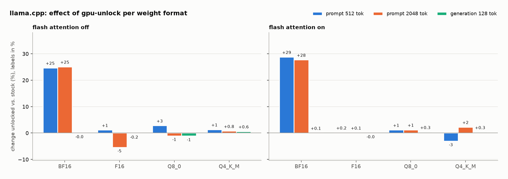
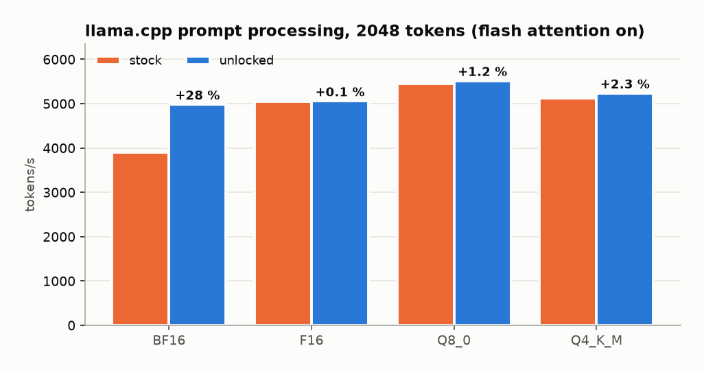

# NVIDIA GeForce RTX 3070 Ti Laptop GPU (HP Omen 16-k0620ng) – gpu-unlock and llama.cpp (GGUF models)

*Generated 2026-10-26T13:28:38.480+01:00, suite v1.0.0. Baseline `20261026-131748_baseline`, unlocked `20261026-120606_unlocked_unlocked-first`.*

## Summary

**Flash attention on** – change in tokens/s (unlocked vs. baseline, median):

| Weights | pp512 | pp2048 | tg128 |
|---|---:|---:|---:|
| BF16 | +28.8 % | +27.7 % | +0.1 % ¹ |
| F16 | +0.2 % ¹ | +0.1 % ¹ | -0.0 % ¹ |
| Q8_0 | +1.2 % ¹ | +1.2 % ¹ | +0.3 % ¹ |
| Q4_K_M | -3.0 % | +2.3 % ¹ | +0.3 % ¹ |

**Flash attention off** – change in tokens/s (unlocked vs. baseline, median):

| Weights | pp512 | pp2048 | tg128 |
|---|---:|---:|---:|
| BF16 | +24.7 % | +25.1 % | -0.0 % ¹ |
| F16 | +1.1 % ¹ | -5.4 % | -0.2 % ¹ |
| Q8_0 | +2.8 % | -1.0 % ¹ | -1.1 % ¹ |
| Q4_K_M | +1.3 % ¹ | +0.8 % ¹ | +0.6 % ¹ |

¹ sample ranges of both phases overlap (difference within run-to-run noise).

<picture>
  <source media="(prefers-color-scheme: dark)" srcset="charts/llamacpp_change_dark.png">
  
</picture>

<picture>
  <source media="(prefers-color-scheme: dark)" srcset="charts/llamacpp_pp2048_fa-on_dark.png">
  
</picture>

How llama.cpp computes each weight format on this GPU (llama.cpp CUDA backend):

- **BF16** – cuBLAS, BF16 inputs with **FP32 accumulation** – the path gpu-unlock targets
- **F16** – cuBLAS, FP16 inputs with **FP16 accumulation** – not rate-limited on GeForce
- **Q8_0** – MMQ kernels, INT8 tensor-core math
- **Q4_K_M** – MMQ kernels, INT8 tensor-core math (4-bit weights unpacked to INT8)

## Test system

| | |
|---|---|
| GPU | NVIDIA GeForce RTX 3070 Ti Laptop GPU (0x24E010DE), VBIOS 94.04.7C.00.10, max power 150.00 W |
| Host | 12th Gen Intel(R) Core(TM) i9-12900H, Ubuntu 24.04.5 LTS, kernel 7.0.0-38-generic |
| Driver | 595.99.02 (open) |
| llama.cpp | fd8f8451a 2026-10-26 tests : refactor test-llama-archs to not link internal libllama symbols (#30880), built with Build cuda_12.6.r12.6/compiler.35059454_0 for sm_86 |
| Models | `qwen2.5-3b-instruct-BF16.gguf` 6.18 GB; `qwen2.5-3b-instruct-F16.gguf` 6.18 GB; `qwen2.5-3b-instruct-Q4_K_M.gguf` 1.93 GB; `qwen2.5-3b-instruct-Q8_0.gguf` 3.29 GB |
| Conditions | profile `performance`, AC True, Runtime D3 `Disabled`, nvidia-powerd active |
| gpu-unlock | af28cbb 2026-10-24 Merge pull request #37 from tsondo/claude/wizardly-turing-ecpa8w |

## Validity checks

| Check | Result | Detail |
|---|---|---|
| Baseline boot is stock | pass | stock |
| Unlocked boot reports 'gpu_unlock: unlocked' | pass | unlocked |
| Same llama.cpp build | pass | fd8f8451a / fd8f8451a |
| Identical model files (SHA-256) | pass | qwen2.5-3b-instruct-BF16.gguf, qwen2.5-3b-instruct-F16.gguf, qwen2.5-3b-instruct-Q4_K_M.gguf, qwen2.5-3b-instruct-Q8_0.gguf |
| Same NVIDIA driver | pass | 595.99.02 / 595.99.02 |
| Same VBIOS | pass | 94.04.7C.00.10 / 94.04.7C.00.10 |
| Same max power limit | pass | 150.00 W / 150.00 W |
| Same kernel | pass | 7.0.0-38-generic / 7.0.0-38-generic |
| Same platform_profile | pass | performance / performance |
| Same ac_online | pass | True / True |
| Same nvidia_runtime_d3 | pass | Disabled / Disabled |
| Same GGML environment overrides | pass | {"GGML_CUDA_CUBLAS_COMPUTE_TYPE": null, "GGML_CUDA_FORCE_MMQ": null, "GGML_CUDA_FORCE_CUBLAS": null, "CUDA_VISIBLE_DEVICES": null} |
| No run forced past preflight | pass | - / - |
| All layers offloaded to GPU in every test | pass | n_gpu_layers seen: ['99'] |
| Token-generation controls unchanged (±5 %) | pass | BF16_tg128_fa-off -0.0%, BF16_tg128_fa-on +0.1%, F16_tg128_fa-off -0.2%, F16_tg128_fa-on -0.0%, Q8_0_tg128_fa-off -1.1%, Q8_0_tg128_fa-on +0.3%, Q4_K_M_tg128_fa-off +0.6%, Q4_K_M_tg128_fa-on +0.3% |
| Measurement noise acceptable (max CV < 5 %) | pass | median CV 1.14 %, worst 3.14 % |

## Method

- One source model (`qwen2.5-3b-instruct`) converted once to BF16 GGUF and quantised from it, so all variants are the same network. Both phases use the identical llama.cpp build and identical files (SHA-256 checked).
- Each test is one `llama-bench` call with `-ngl 99 -r 7` (warm-up run included by llama-bench), flash attention off and on. The reported value is the median of the repetitions (`samples_ts`).
- Before each test the GPU cools to ≤ 55 °C (min 10 s, max 120 s). Power/clock/temperature are averaged over the whole llama-bench call, including model loading, so watts here are indicative only.
- *pp* = prompt processing (prefill), *tg* = token generation. Token generation is memory-bandwidth bound and serves as the control: it must not change.

## All results

| Test | Expect | Baseline tok/s | Unlocked tok/s | Change | Range | Sep. | Avg W B→U | Max °C B→U |
|---|---|---:|---:|---:|---|:-:|---|---|
| BF16_pp512_fa-off | gain | 3,699.2 | 4,612.4 | **+24.7 %** | +20.8 % … +27.5 % | yes | 35 → 38 | 56 → 56 |
| BF16_pp2048_fa-off | gain | 3,068.8 | 3,839.0 | **+25.1 %** | +24.1 % … +28.6 % | yes | 71 → 65 | 56 → 56 |
| BF16_tg128_fa-off | control | 52.4 | 52.4 | **-0.0 %** | -0.8 % … +0.8 % | no | 92 → 91 | 59 → 59 |
| BF16_pp512_fa-on | gain | 4,110.7 | 5,294.6 | **+28.8 %** | +27.1 % … +35.8 % | yes | 40 → 37 | 56 → 56 |
| BF16_pp2048_fa-on | gain | 3,901.5 | 4,983.1 | **+27.7 %** | +20.5 % … +33.9 % | yes | 70 → 64 | 56 → 55 |
| BF16_tg128_fa-on | control | 53.3 | 53.3 | **+0.1 %** | -0.4 % … +0.7 % | no | 92 → 93 | 59 → 58 |
| F16_pp512_fa-off | info | 4,666.0 | 4,719.3 | **+1.1 %** | -0.9 % … +2.7 % | no | 31 → 34 | 55 → 55 |
| F16_pp2048_fa-off | info | 3,855.0 | 3,647.6 | **-5.4 %** | -9.1 % … -2.8 % | yes | 70 → 63 | 55 → 55 |
| F16_tg128_fa-off | control | 52.6 | 52.5 | **-0.2 %** | -0.6 % … +0.8 % | no | 92 → 92 | 58 → 59 |
| F16_pp512_fa-on | info | 5,422.6 | 5,432.1 | **+0.2 %** | -7.7 % … +2.0 % | no | 35 → 42 | 55 → 56 |
| F16_pp2048_fa-on | info | 5,049.3 | 5,055.6 | **+0.1 %** | -5.6 % … +7.2 % | no | 66 → 64 | 54 → 55 |
| F16_tg128_fa-on | control | 53.5 | 53.5 | **-0.0 %** | -0.8 % … +0.8 % | no | 92 → 91 | 57 → 58 |
| Q8_0_pp512_fa-off | info | 4,968.3 | 5,108.4 | **+2.8 %** | +1.3 % … +3.7 % | yes | 31 → 30 | 54 → 55 |
| Q8_0_pp2048_fa-off | info | 4,129.0 | 4,086.1 | **-1.0 %** | -5.8 % … +3.5 % | no | 68 → 64 | 55 → 56 |
| Q8_0_tg128_fa-off | control | 90.3 | 89.3 | **-1.1 %** | -2.2 % … +1.4 % | no | 87 → 83 | 56 → 57 |
| Q8_0_pp512_fa-on | info | 5,943.8 | 6,014.1 | **+1.2 %** | -0.3 % … +2.0 % | no | 35 → 36 | 53 → 54 |
| Q8_0_pp2048_fa-on | info | 5,448.5 | 5,515.3 | **+1.2 %** | -5.6 % … +9.2 % | no | 67 → 66 | 53 → 54 |
| Q8_0_tg128_fa-on | control | 92.5 | 92.8 | **+0.3 %** | -1.2 % … +1.8 % | no | 84 → 85 | 55 → 56 |
| Q4_K_M_pp512_fa-off | info | 4,845.3 | 4,909.7 | **+1.3 %** | -1.2 % … +3.8 % | no | 43 → 39 | 52 → 53 |
| Q4_K_M_pp2048_fa-off | info | 3,945.5 | 3,975.2 | **+0.8 %** | -1.1 % … +6.9 % | no | 76 → 73 | 53 → 54 |
| Q4_K_M_tg128_fa-off | control | 127.5 | 128.3 | **+0.6 %** | -3.9 % … +5.2 % | no | 82 → 81 | 55 → 55 |
| Q4_K_M_pp512_fa-on | info | 5,570.7 | 5,401.2 | **-3.0 %** | -3.8 % … -2.2 % | yes | 39 → 37 | 54 → 53 |
| Q4_K_M_pp2048_fa-on | info | 5,118.8 | 5,235.1 | **+2.3 %** | -3.3 % … +4.4 % | no | 73 → 71 | 53 → 53 |
| Q4_K_M_tg128_fa-on | control | 134.2 | 134.6 | **+0.3 %** | -3.8 % … +3.0 % | no | 82 → 81 | 55 → 54 |

## Raw data

- `20261026-131748_baseline`: [run.log](../../../results/llamacpp/20261026-131748_baseline/run.log), [results.jsonl](../../../results/llamacpp/20261026-131748_baseline/results.jsonl), [results.csv](../../../results/llamacpp/20261026-131748_baseline/results.csv), [telemetry.csv](../../../results/llamacpp/20261026-131748_baseline/telemetry.csv), [llama-bench raw output](../../../results/llamacpp/20261026-131748_baseline/raw/), [env.json](../../../results/llamacpp/20261026-131748_baseline/env.json), [manifest.json](../../../results/llamacpp/20261026-131748_baseline/manifest.json)
- `20261026-120606_unlocked_unlocked-first`: [run.log](../../../results/llamacpp/20261026-120606_unlocked_unlocked-first/run.log), [results.jsonl](../../../results/llamacpp/20261026-120606_unlocked_unlocked-first/results.jsonl), [results.csv](../../../results/llamacpp/20261026-120606_unlocked_unlocked-first/results.csv), [telemetry.csv](../../../results/llamacpp/20261026-120606_unlocked_unlocked-first/telemetry.csv), [llama-bench raw output](../../../results/llamacpp/20261026-120606_unlocked_unlocked-first/raw/), [env.json](../../../results/llamacpp/20261026-120606_unlocked_unlocked-first/env.json), [manifest.json](../../../results/llamacpp/20261026-120606_unlocked_unlocked-first/manifest.json)
